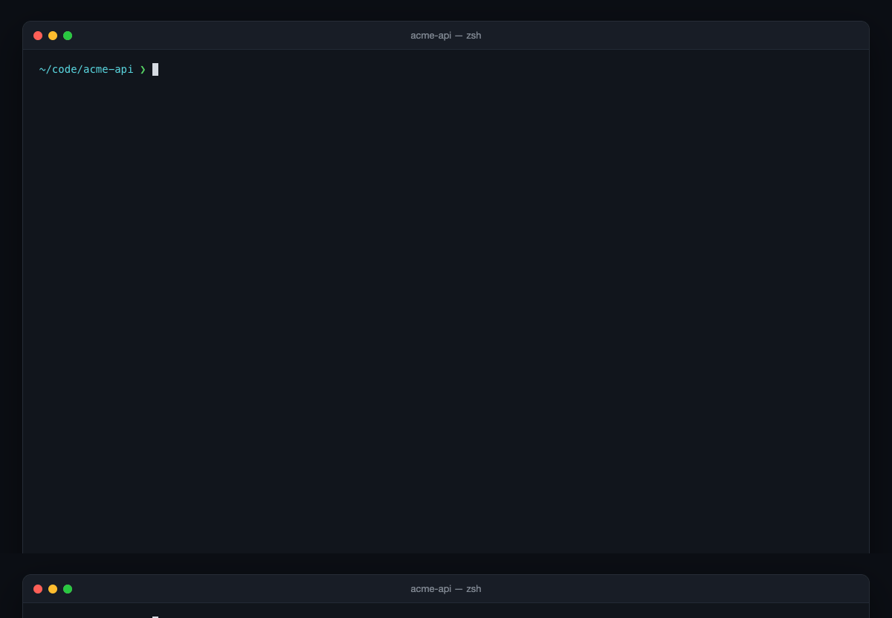

<div align="center">

# agent-ready

**Lighthouse for AI coding agents.**
Score how well Claude Code, Codex and Cursor can work in your repo — then auto-fix the gaps.

[](https://github.com/mintwork/agent-ready/actions/workflows/ci.yml) [](https://www.npmjs.com/package/@mintwork/agent-ready) [](https://www.npmjs.com/package/@mintwork/agent-ready#provenance) [](package.json) [](LICENSE) [](https://github.com/mintwork/agent-ready) [](package.json) [](https://github.com/mintwork/agent-ready/stargazers)



```bash
npx @mintwork/agent-ready
```

</div>

---

Your agent is only as good as the repo you drop it into. No `AGENTS.md`? It guesses your test
command. Stale `CLAUDE.md`? It confidently edits files that were deleted months ago. `dist/` not
ignored? It greps your minified bundle and burns half its context window. A `build` script that
runs `npm publish`? Good luck.

`agent-ready` checks all of that in **under a second** and gives you a 0–100 score, a category
breakdown, and a punch list of fixes — many of which it can apply for you.

## What it looks like

```text
$ npx @mintwork/agent-ready ~/code/my-app

  agent-ready v0.1.0  ~/code/my-app
  5 files · javascript · 7ms

  Agent-ready score  31/100  ███████░░░░░░░░░░░░░░░░░  Poor

  Context docs      53  ███████████░░░░░░░░░  weight 30%
  Feedback loops     0  ░░░░░░░░░░░░░░░░░░░░  weight 25%
  Navigability      39  ████████░░░░░░░░░░░░  weight 20%
  Type safety       25  █████░░░░░░░░░░░░░░░  weight 15%
  Safety            38  ████████░░░░░░░░░░░░  weight 10%

  Context docs
   ✗ Docs are not stale (referenced paths/scripts exist) (40%) — 3 stale reference(s) out of 3
       · CLAUDE.md references missing path `lib/old-entry.js`
       · CLAUDE.md references missing package.json script "start:dev"
       → Update or remove references to files/scripts that no longer exist.
   ✗ Docs list build/test/lint commands (33%) — Missing test, lint command(s) in context docs
       → Add a "Commands" section with exact test/lint commands.  [fixable: --fix]

  Feedback loops
   ✗ Test command is discoverable (0%) — Tests: no JS tests
   ✗ Linter configured (0%) — Lint: no JS linter

  Navigability
   ✗ No oversized source files (>1000 lines) (0%) — 1 of 2 source files exceed 1000 lines
       · src/legacy.js 1400 lines

  Safety
   ✗ No secrets in the repo (50%) — 1 possible secret(s) visible to agents
       · .env dotenv file is visible in the repo
   ✗ No dangerous scripts (0%) — 3 risky script command(s)
       · package.json script "setup" pipes a remote script into a shell
       · package.json script "build" publishes a package — an agent running "build" would release

  Next: agent-ready --fix to auto-fix 3 check(s) · agent-ready --badge for a README badge
```

Then:

```text
$ npx @mintwork/agent-ready --fix

Updated CLAUDE.md — Append detected build/test/lint commands; Append an Architecture section
Created AGENTS.md — AGENTS.md pointing at the existing CLAUDE.md
Created .gitignore — Create .gitignore so dependency/build dirs stay out of agent context

  Score: 31 → 40
```

## Show off your score

```bash
npx @mintwork/agent-ready --badge
```

```markdown
[](https://github.com/mintwork/agent-ready)
```

Paste it at the top of your README. It tells contributors — human and AI — that your repo is
ready for them. (This repo scores 100/100, and CI fails if it drops below 90.)

## Install

```bash
npx @mintwork/agent-ready            # no install
npm i -D @mintwork/agent-ready       # or pin it in your project
```

Node 22+. Zero runtime dependencies. Works on JS/TS and Python repos, with basic Go and Rust support. Read-only unless you pass `--fix`.

## Usage

```text
npx @mintwork/agent-ready [path] [options]

  --json             Machine-readable JSON report
  --badge            Print a shields.io badge (markdown) for your README
  --sarif            SARIF 2.1.0 report for GitHub code scanning
  --fix              Apply safe auto-fixes (AGENTS.md/CLAUDE.md, missing doc sections, .gitignore,
                     .cursorignore/.ignore, .env.example) and print a strict-mode migration plan
  --dry-run          With --fix: show the diff without writing
  --force            With --fix: allow overwriting existing files
  --run              Execute the test command and score its speed
  --min-score <n>    Exit 1 if the score is below n (CI gating)
  --verbose, -v      Show passing checks and all findings
  --no-color         Disable colors
```

**`--fix` is conservative.** It creates missing files and appends to existing ones (`.gitignore`,
missing sections in your context doc). It never rewrites content you wrote unless you pass
`--force`, and it always prints a diff. Generated docs never recommend scripts that publish or delete.

It also:

- **Hides committed generated code** (minified bundles, vendored libraries, `generated/` dirs) by
  appending it to `.cursorignore` (Cursor) and `.ignore` (ripgrep, used by Claude Code and Codex).
  The files stay in git.
- **Writes `.env.example`** from the environment variables your code reads (`process.env.X`,
  `import.meta.env.X`, `os.getenv`, `os.Getenv`, `env::var`). It only does this when the project
  loads `.env` files and has no template yet. It writes names only: values from your local `.env`
  are never copied.
- **Prints a TypeScript strict-mode migration plan** when a tsconfig isn't `strict`. The plan lists
  the remaining strict flags in a sensible order, each with the `tsc --noEmit --<flag>` command that
  previews its errors. It never edits your tsconfig.

## What it checks

| Category           | Weight | Checks                                                                                                                                                                                                                                                                                                                                                                                                                                                                                                                                  |
| ------------------ | ------ | --------------------------------------------------------------------------------------------------------------------------------------------------------------------------------------------------------------------------------------------------------------------------------------------------------------------------------------------------------------------------------------------------------------------------------------------------------------------------------------------------------------------------------------- |
| **Context docs**   | 30%    | `AGENTS.md` / `CLAUDE.md` / `.cursor/rules` / Copilot / Gemini instructions exist · they list exact build, test and lint commands · they describe architecture and key directories · **not stale**: every referenced path and `npm run` script actually exists · not too long (or too thin) · both `AGENTS.md` and `CLAUDE.md` so every agent is covered · `.cursor/rules/*.mdc` actually apply (frontmatter, globs that match files) · monorepos: large workspace packages have a nested `AGENTS.md` or are mentioned in the root docs |
| **Feedback loops** | 25%    | A discoverable test command (package.json `test`, pytest config, `make test`, `cargo test`, `go test`) · linter configured (eslint, biome, oxlint, ruff, flake8, clippy, golangci-lint) · typecheck command (`tsc`, mypy, pyright) · CI config · `--run`: test suite passes and is fast                                                                                                                                                                                                                                                 |
| **Navigability**   | 20%    | `node_modules`, `.venv`, `dist`, caches ignored (and not committed) · no source files over 1000 lines · no minified/vendored/generated blobs in agent view · shallow directory tree · README                                                                                                                                                                                                                                                                                                                                            |
| **Type safety**    | 15%    | TypeScript `strict` across root and package tsconfigs (follows `extends`, incl. workspace packages), `any` / `@ts-ignore` / `@ts-nocheck` density · plain JS penalized · Python type-hint coverage of product code + mypy/pyright config · Go/Rust count as compiler-checked                                                                                                                                                                                                                                                            |
| **Safety**         | 10%    | Committed `.env` / keys / credentials files · AWS, GitHub, Slack, Stripe, OpenAI, Anthropic, Google, npm token patterns · dangerous scripts: `rm -rf ~`, `curl \| sh`, force-push, `npm publish` hidden in `build`/`test`, network calls in install hooks                                                                                                                                                                                                                                                                               |

Checks that don't apply (e.g. Python checks in a TS repo) are marked n/a and excluded from the score.
Agent-tooling checks (MCP, hooks, permissions, Cursor rules) are n/a unless the repo ships that
config, so you're never penalized for not using a tool.
In polyglot repos, per-language parts are weighted by each language's share of the code, so a tooling
`package.json` in a Rust repo doesn't count as much as the Rust itself. Secrets in tests, fixtures and
examples are listed (with `--verbose`) but don't lower the score.

**Monorepos.** npm, pnpm, yarn and bun workspaces, Cargo workspaces and Go multi-module repos
(`go.work`, or nested `go.mod`) are detected automatically. Each package is also scored on its own
for feedback loops, navigability and type safety, with root linter/TypeScript configs and root
`package.json` scripts counted as covering it. The report shows a per-package breakdown and a
code-size-weighted aggregate (`workspaces` in `--json`); the headline score stays repo-wide.
Examples, test helpers and docs packages are skipped.

```text
  Workspaces  pnpm · 13 package(s) · aggregate 93/100
    packages/expect      84  ████████░░  in root docs · no oversized source files (>1000 lines)
    packages/vitest      89  █████████░  in root docs · no oversized source files (>1000 lines)
```

**Generated docs earn partial credit.** An `AGENTS.md` created by `--fix` still carries a
`Generated by agent-ready` marker and TODO placeholders. Until a human edits it, the content checks
(context file present, commands, architecture, freshness, length) score at most 50%, so `--fix`
alone can't pass for hand-written context. Credit comes back as you replace the TODOs with real
content: it scales with the share of TODOs filled in _and_ the amount of new text you write (deleting
the TODOs without writing anything earns nothing), and the last 10% unlocks when you remove the
marker. The report shows what's left: `Fill in the TODO sections in AGENTS.md to unlock the
remaining +13 points.`

"Agent-visible" means what ripgrep-based agents actually see: `git ls-files` minus anything in
`.gitignore`, `.ignore`, `.rgignore` or `.cursorignore`.

## CI: fail PRs that make your repo worse for agents

```yaml
# .github/workflows/agent-ready.yml
name: agent-ready
on: [pull_request]
jobs:
  agent-ready:
    runs-on: ubuntu-latest
    steps:
      - uses: actions/checkout@v7
      - uses: actions/setup-node@v7
        with: { node-version: lts/* }
      - run: npx --yes @mintwork/agent-ready@latest . --min-score 75
```

A reusable composite action is also included (`action.yml`, inputs `path`, `min-score`, `version`,
`sarif`, `sarif-category`; outputs `score` and `sarif-file`, plus a job summary with your badge):

```yaml
- uses: mintwork/agent-ready@v0
  with: { min-score: 75 }
```

Set `sarif: true` to also upload the findings to GitHub code scanning, so they show up as alerts
on the files they're about (the job needs `security-events: write`):

```yaml
permissions:
  contents: read
  security-events: write
steps:
  - uses: actions/checkout@v7
  - uses: mintwork/agent-ready@v0
    with: { min-score: 75, sarif: true }
```

`--sarif` reports every check as a rule and every finding of a check that isn't fully passing as a
result. Repo-level problems (no CI, no context file) are anchored at your `AGENTS.md`/`README.md`.
Safety checks carry a `security-severity`, so leaked secrets rank as high-severity alerts.

`@v0` tracks the latest 0.x release; pin `@v0.1.0` for a fixed version. The action runs the
agent-ready release matching the tag you use, unless you override it with `version`.

See [`examples/github-action.yml`](examples/github-action.yml).

## Configuration

Optional `agent-ready.config.json` (or an `"agent-ready"` key in package.json):

```json
{
  "ignore": ["test/fixtures/**", "vendor/**"],
  "disable": ["nav.depth", "types"]
}
```

`disable` takes check ids (`--verbose` and `--json` show them) or whole categories. Silence a single
secret false positive with an `agent-ready-ignore` comment on the same line.

## Programmatic API

```ts
import { scan, builtinChecks, type Check } from '@mintwork/agent-ready';

const noTodos: Check = {
  id: 'custom.no-todo-md',
  category: 'context',
  title: 'No TODO.md left lying around',
  weight: 1,
  run: (ctx) =>
    ctx.has('TODO.md') ? { score: 0, summary: 'TODO.md found' } : { score: 1, summary: 'clean' },
};

const report = await scan('.', { checks: [...builtinChecks, noTodos] });
console.log(report.score, report.categories);
```

Every check is a plain object with `run(ctx)` returning a 0–1 score and optional `fix(ctx)` that
proposes file changes. Adding one is ~30 lines — see [CONTRIBUTING.md](CONTRIBUTING.md).

## How is this different from a linter?

ESLint tells you your code is wrong. `agent-ready` tells you your **repo** is hard to work in —
for the coworker who reads every file literally, never asks a clarifying question, and runs
whatever `npm run build` does.

## Roadmap

- [ ] Deeper Go and Rust checks (unsafe/`interface{}` density, nested `Cargo.toml` workspaces) and Java/Kotlin support
- [ ] `--run` for lint/typecheck too, and flaky-test detection (run twice, compare)
- [x] Monorepo awareness: score each workspace package, check nested `AGENTS.md`
- [ ] Doc staleness via git history (doc untouched while referenced code churned)
- [x] MCP/tooling checks (`.mcp.json`, Claude Code hooks, `.claude/settings.json` permissions, `.cursor/rules`)
- [x] Smarter `--fix`: `tsconfig` strict migration plan, `.cursorignore` for generated code, `.env.example`
- [x] SARIF output for GitHub code scanning (`--sarif`, action input `sarif: true`)
- [ ] Public leaderboard of popular open-source repos

Ideas and PRs welcome — especially new checks backed by real agent failure modes.

## License

MIT
